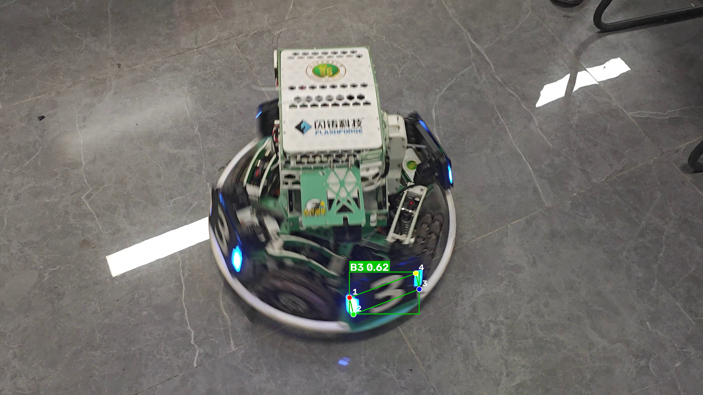
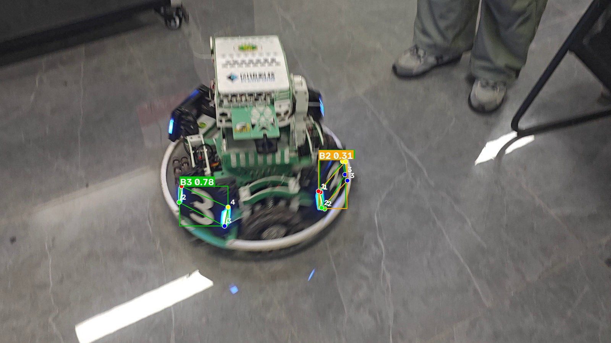

# yolo-armor-inference

RoboMaster 装甲板四关键点检测：使用课程提供的 **YOLO26n 装甲板模型 `best.pt`**
对自行拍摄的装甲板视频做逐帧推理，输出带**检测框、类别、置信度和 4 个关键点**的可视化结果视频。

> 课程第一次作业：创建公开仓库 → 拍摄装甲板视频 → 使用指定模型推理 → 通过一次 PR 合并到主分支。

---

## 1. 项目完成的功能

`infer.py` 是本次作业的核心脚本，功能包括：

1. **加载模型**：读取课程"参考材料"提供的 YOLO26n 装甲板四关键点权重 `best.pt`
   （类别 B1、B2、B3、R1、R2、R3，每个目标输出 4 个二维关键点）。
2. **读取视频**：读取自行拍摄的装甲板视频，逐帧送入模型推理（支持 MP4 / MOV / AVI / WebM 等）。
3. **可视化**：在画面上绘制
   * 检测框（每个类别一种颜色）；
   * 类别名称与置信度，例如 `B1 0.87`；
   * **模型预测的 4 个关键点**（不是检测框的四个角点），每个关键点按序号着色，
     旁边标注序号 1~4，并用与检测框同色的四边形把它们连起来，便于看出关键点属于哪个目标。
4. **保存结果视频**：输出与原视频**同分辨率、同帧率、帧数一一对应**的 MP4 文件，可正常播放。
5. **附加产物（可选）**：逐帧检测明细 CSV、代表性截图、统计信息 JSON。
6. **参数化**：模型路径、视频路径、输出位置、置信度阈值、设备等全部可用命令行参数修改。

> 关键点说明：代码中的关键点坐标全部取自模型的 `keypoints` 预测输出
> （对应 `results[0].keypoints.xy`），不使用检测框的角点代替。
> 模型对缺失关键点会输出 `(0, 0)` 占位，脚本会自动跳过这类点、不参与连线。

---

## 2. 运行环境与依赖

### 2.1 Python 版本

* **Python 3.10 及以上**，本项目在 **Python 3.14.6** 上开发并验证通过。
* 无其他编译型依赖，`pip` 直接安装即可。

### 2.2 主要依赖

完整列表见 [`requirements.txt`](requirements.txt)。实际验证通过的版本：

| 依赖 | 版本 | 用途 |
| --- | --- | --- |
| ultralytics | 8.4.175 | 加载 YOLO 权重、执行推理 |
| torch | 2.14.1 | 推理后端 |
| torchvision | 0.29.1 | torch 配套库 |
| opencv-python | 5.0.0.93 | 视频读写、绘制 |
| numpy | 2.5.4 | 数值处理 |

（`ultralytics` 还会自动安装 `matplotlib`、`polars`、`psutil` 等依赖，无需手动处理。）

### 2.3 使用 CPU 还是 GPU

* **两种都支持，本作业不要求实时推理。**
* 脚本默认 `--device auto`：检测到可用的 CUDA 环境就用 GPU，否则自动回退到 CPU，
  运行时会在日志中打印实际使用的设备。
* 也可以显式指定：`--device cpu`、`--device 0`。
* 本次作业的实际推理运行在 **CPU** 上（`torch 2.14.1+cpu`，启动日志显示"CUDA 可用: False"）：
  在 4K（3840×2160）611 帧的视频上平均 12.5~18.3 FPS，单帧推理约 18 ms，满足作业"不要求实时推理"的要求。
* 机器上装有 NVIDIA GeForce RTX 5060 Laptop（8 GB）与 CUDA 13.1 驱动，
  按上面的命令装上 CUDA 版 torch 后，`--device auto` 会自动改用 GPU，代码无需修改。

如需在本机启用 GPU，先按 [PyTorch 官方安装选择器](https://pytorch.org/get-started/locally/)
给出的命令安装 CUDA 版 torch（`pip install -r requirements.txt` 默认装到的是 CPU 版），例如：

```bash
pip install torch torchvision --index-url https://download.pytorch.org/whl/cu128
pip install ultralytics opencv-python
```

---

## 3. 模型权重准备

模型权重由课程参考材料统一提供，**不包含在本仓库中**（已在 `.gitignore` 中排除 `*.pt`）。

1. 从作业页面"参考材料"下载 `best.pt`；
2. 放到本仓库的 `weights/` 目录下，目录结构如下：

```
yolo-armor-inference/
└── weights/
    └── best.pt        ← 放这里（脚本默认读取该路径）
```

如权重放在其他位置，用参数指定即可：

```bash
python infer.py --weights D:/models/best.pt --source data/armor.mp4
```

若文件缺失，脚本会直接给出提示而不是报栈：

```
[错误] 找不到模型权重: weights/best.pt
        请按 README「模型权重准备」把 best.pt 放到该位置，或用 --weights 指定其他路径。
```

---

## 4. 安装依赖、运行命令与结果位置

### 4.1 依赖安装

```bash
# 1) 克隆仓库
git clone https://github.com/<你的用户名>/yolo-armor-inference.git
cd yolo-armor-inference

# 2) 创建并激活虚拟环境（可选但推荐）
python -m venv .venv
.venv\Scripts\activate          # Windows
# source .venv/bin/activate     # Linux / macOS

# 3) 安装依赖
pip install -r requirements.txt
```

### 4.2 准备输入文件

| 文件 | 放置位置 | 说明 |
| --- | --- | --- |
| 模型权重 | `weights/best.pt` | 见第 3 节 |
| 原始视频 | `data/` 目录下任意文件名 | 自行拍摄的装甲板视频，作业提交时也作为附件上传 |

`data/`、`outputs/`、`snapshots/` 和所有视频文件、权重文件均已被 `.gitignore` 排除，
不会进入 Git 历史。

### 4.3 实际运行命令

```bash
python infer.py --weights weights/best.pt --source data/armor.mp4 --output outputs/armor_pred.mp4
```

本作业实际使用的命令（本文档的统计数据与截图均由该命令产生）：

```bash
python infer.py ^
  --weights weights/best.pt ^
  --source robomaster.mp4 ^
  --output outputs/robomaster_pred.mp4 ^
  --out-scale 0.5 ^
  --conf 0.25 --imgsz 640 --device auto ^
  --save-csv --stats-json --save-frames 5
```

> `--out-scale 0.5` 把 4K 结果视频输出为 1920×1080：4K 尺寸用 `mp4v` 编码会得到约 122 MiB 的文件，
> 超过作业附件 100 MiB 的限制；缩放后为 44.9 MiB，画面内容与标记比例不变。
> 如需 4K 原尺寸结果，去掉该参数即可。

只检查权重是否正确（打印类别列表后退出）：

```bash
python infer.py --weights weights/best.pt --source data/armor.mp4 --list-classes
```

### 4.4 结果保存位置

| 产物 | 默认位置 | 说明 |
| --- | --- | --- |
| 结果视频 | `outputs/<视频名>_pred.mp4` | 可用 `--output` 修改 |
| 检测明细 CSV | `outputs/<视频名>_detections.csv` | 需加 `--save-csv` |
| 统计信息 JSON | `outputs/<视频名>_stats.json` | 需加 `--stats-json` |
| 代表性截图 | `snapshots/<视频名>_frameXXXXX.jpg` | 需 `--save-frames > 0`（默认 5 张） |

终端还会打印一段汇总，包含处理帧数、含检测帧数、分类别检出数与平均置信度、
关键点平均置信度、平均处理帧率以及各阶段耗时，可直接用于作业报告：

```
================ 推理结果汇总 ================
处理帧数          : 452
含检测的帧数      : ...
目标总数          : ...
分类别统计        : ...
关键点平均置信度  : ...
平均处理帧率      : ... FPS（含读帧、推理与绘图）
结果视频          : outputs/armor_pred.mp4  (... MiB)
==============================================
```

---

## 5. 命令行参数说明

| 参数 | 默认值 | 说明 |
| --- | --- | --- |
| `--weights, --model, -w` | `weights/best.pt` | 模型权重路径（`--model` 为等价别名） |
| `--source, -s` | `data/armor.mp4` | 输入视频路径 |
| `--output, -o` | `outputs/<视频名>_pred.mp4` | 结果视频路径 |
| `--codec` | 自动 | 视频编码器，依次尝试 `mp4v` → `avc1` → `XVID` |
| `--out-scale` | `1.0` | 结果视频缩放比例，`0.5` 表示 4K 输出为 1080p（用于控制文件体积） |
| `--conf` | `0.25` | 检测置信度阈值 |
| `--iou` | `0.7` | NMS IoU 阈值 |
| `--imgsz` | `640` | 推理输入分辨率 |
| `--max-det` | `30` | 每帧最多保留目标数 |
| `--device` | `auto` | `auto` / `cpu` / `0` / `cuda:0` |
| `--half` | 关闭 | 半精度推理（仅 GPU 有效；部分 ultralytics 版本已弃用该参数，默认不传） |
| `--classes` | 全部 | 只保留指定类别索引，如 `--classes 0 1 2` |
| `--kpt-conf` | `0.0` | 关键点置信度阈值，低于该值不绘制 |
| `--kpt-radius` | 自动 | 关键点半径 |
| `--line-width` | 自动 | 线宽 |
| `--no-connect` | 关闭 | 不绘制关键点之间的连线 |
| `--no-kpt-index` | 关闭 | 不在关键点旁标注序号 |
| `--save-csv` / `--stats-json` | 关闭 | 导出明细 CSV / 统计 JSON |
| `--save-frames` | `5` | 代表性截图数量，`0` 表示不保存 |
| `--frame-dir` | `snapshots` | 截图目录 |
| `--frame-gap` | `45` | 两张截图之间的最小帧间隔 |
| `--keep-audio` | 关闭 | 用 ffmpeg 把原视频音轨并入结果视频（需本机有 ffmpeg） |
| `--max-frames` | `0` | 只处理前 N 帧，调试用（`0` 表示全部） |
| `--list-classes` | 关闭 | 打印模型类别后退出 |

---

## 6. 视频拍摄说明

| 项目 | 内容 |
| --- | --- |
| 拍摄地点 | 水建学院 D414 实验室 |
| 拍摄设备 | Redmi K70（手机拍摄） |
| 视频时长 | 10.2 秒（611 帧） |
| 分辨率与帧率 | 3840×2160（4K），60 FPS，横屏 |
| 文件大小 | 77.6 MiB（`robomaster.mp4`，作为作业附件提交） |
| 拍摄方式 | 手机手持横屏拍摄，镜头自机器人斜上方俯拍并缓慢移动，拍摄距离与角度持续变化 |
| 画面内容 | 实验室大理石地面上的 RoboMaster 机器人，底盘四周装有发光装甲板，
其中正对镜头的"3"号装甲板最清晰，画面中还可见桌子腿和拍摄者鞋部 |
| 光照条件 | 室内人工照明，地面反光明显，装甲板为自发光 LED 数字，画面未过曝 |

拍摄要点（实际执行情况请在上一节记录）：

* 视频长度 10~30 秒，横屏拍摄；
* 优先拍摄模型对应类别（B1/B2/B3/R1/R2/R3）的装甲板；
* 拍摄过程中改变距离与角度，便于观察模型在不同情况下的识别表现；
* 原始视频为自己拍摄，未使用网络视频、训练集素材或他人视频。

---

## 7. 结果展示（检测框 + 关键点）

以下两张截图直接取自本次推理结果（源视频第 96 帧与第 3 帧，`snapshots/` 目录下的原图另存于此）：





截图说明：

* 图 1（源视频第 96 帧）：机器人底部的"3"号装甲板被检为 **B3，置信度 0.62**。
  绿色矩形为检测框，左上角标签同时给出类别与置信度；4 个彩色圆点
  （1 红 / 2 绿 / 3 蓝 / 4 黄）为模型预测的关键点，落在装甲板轮廓附近，
  并由与检测框同色的四边形连起来。所有关键点坐标均来自模型的预测输出，未使用检测框角点代替。
* 图 2（源视频第 3 帧）：同一帧中检出 **B3（0.78）** 与 **B2（0.31）** 两块装甲板，
  两个目标使用不同颜色绘制，便于区分关键点归属。

> 截图生成方式：运行脚本时加 `--save-frames 5`，会自动把含检测的帧存到 `snapshots/`；
> 挑选清晰、有代表性的帧复制到 `docs/images/` 即可（`snapshots/` 不入库，`docs/images/` 入库）。

---

## 8. 实际识别表现、遇到的问题及处理方法

### 8.1 实际识别表现

| 指标 | 实际结果 |
| --- | --- |
| 视频总帧数 / 时长 | 611 帧 / 10.2 秒（3840×2160 @ 60 FPS） |
| 含检测的帧数 / 占比 | 419 帧 / **68.6%** |
| 检出目标总数 | 591 个 |
| 分类别检出数 | **B3：506、B2：81、B1：4**；R1 / R2 / R3：0 |
| 各类别平均置信度 | B3：0.661、B2：0.445、B1：0.290 |
| 关键点平均置信度 | 不适用 —— 该权重的 `kpt_shape` 为 `[4, 2]`，只输出关键点 x/y 坐标，不输出关键点置信度 |
| 平均处理帧率（含读帧与绘图） | 12.5 ~ 18.3 FPS（CPU） |
| 平均单帧耗时 | 总计约 20 ms：预处理 1.6 ms + 推理 18.0 ms + 后处理 0.4 ms |

以上数字来自终端汇总与 `outputs/robomaster_stats.json`。

### 8.2 观察到的现象与问题

1. **漏检**：视频中机器人侧面、背面的装甲板在倾斜角度大、运动模糊明显时基本检不到；
   全程稳定检出的只有正对镜头、轮廓清晰的"3"号装甲板。含检测帧占 68.6%，
   未检出的 31.4% 主要集中在机器人转动、画面快速移动的时段。
2. **误检 / 多检**：少数模糊帧上同一块装甲板会出现 2 个重叠框（例如第 194 帧
   `B3 0.37 + B3 0.36 + B2 0.35 + B2 0.35`），置信度均在 0.25~0.4 之间，属于 NMS 后残留的低分重复框。
3. **类别错误**：未观察到明显的类别混淆（没有把 B3 判成 B2 这类情况）。
   但 B2 的平均置信度（0.445）明显低于 B3（0.661），说明侧面装甲板在这个拍摄角度下特征更弱。
4. **关键点位置不准确**：快速移动或模糊的帧里，关键点会偏离装甲板轮廓（部分点落到板边缘外）；
   在机器人相对静止、画面清晰的帧（如第 96、141 帧）里，4 个关键点基本贴合装甲板四角。
5. **类别覆盖限制**：视频里只出现了蓝方装甲板，因此 R1/R2/R3 三个类别 0 检出。
   这是输入内容的限制，不是模型漏检。

### 8.3 原因分析与处理方法

| 问题 | 处理方法 | 处理后的效果 |
| --- | --- | --- |
| 运动模糊导致漏检与关键点偏移 | 在镜头稳定、机器人缓慢移动的时段取样观察；需要提高召回时可降低 `--conf` 复测 | 稳定时段检测与关键点位置明显更好；降低阈值会引入更多低分框，本次仍保留 0.25 |
| 4K 结果视频 122 MiB，超过附件 100 MiB 限制 | 增加 `--out-scale 0.5`，输出 1920×1080 | 降到 44.9 MiB，帧数与帧率与原视频一致，标记比例不变 |
| `--codec avc1` 写出的文件无法播放 | 定位为本机 OpenCV 缺少 OpenH264 库，改回默认 `mp4v` | 结果视频正常播放 |
| 缺少关键点置信度、无法按阈值过滤关键点 | 脚本对 `kpt_shape [4, 2]` 做兼容：无置信度时全部绘制，仅跳过 `(0, 0)` 占位点 | 关键点正常显示，不影响可视化 |

### 8.4 无有效检测时的排查过程

本次运行有检出，以下为预备的排查顺序（其中第 1、3 条本次已实际执行）：

1. **权重是否正确**：`--list-classes` 打印的类别应为 B1/B2/B3/R1/R2/R3 共 6 类，
   并提示"关键点形状: [4, 2]"（本作业权重只输出 4 个关键点的 x/y 坐标，不含关键点置信度）；
   如果类别是 COCO 的 80 类，说明加载了错误的权重。
2. **视频是否正确读入**：启动日志会打印 `视频: xxx | 宽x高 | FPS | 约 N 帧`，
   若尺寸为 0 或帧数为 0，说明视频路径或编码有问题。
3. **阈值是否过高**：先用 `--conf 0.05 --kpt-conf 0` 复测，确认模型本身能检出目标。
4. **画面内容**：确认视频中确实有装甲板且画面未严重模糊/过曝。
5. **设备与精度**：显式改用 `--device cpu` 排除 GPU 相关问题。

本次实际执行过的检查：

* `python infer.py --list-classes`：输出 `任务类型: pose | 关键点形状: [4, 2]` 与 6 个类别
  `{0: 'B1', 1: 'B2', 2: 'B3', 3: 'R1', 4: 'R2', 5: 'R3'}`，确认加载的是作业指定权重；
* 阈值验证：用一张与装甲板无关的普通照片（ultralytics 自带的 `bus.jpg`）实测，
  `--conf 0.25` 下检出 0 个目标，`--conf 0.001` 下才出现 12 个置信度不超过 0.056 的低分框，
  说明默认阈值 0.25 能有效抑制背景误检。

---

## 9. 目录结构

```
yolo-armor-inference/
├── infer.py                 # 推理与可视化主脚本
├── requirements.txt         # 依赖说明
├── README.md                # 本文档
├── .gitignore               # 排除权重、视频、运行产物、虚拟环境
├── weights/
│   ├── README.md            # 权重放置说明
│   └── best.pt              # 课程提供的权重（不提交，需自行放入）
├── data/                    # 自行拍摄的原始视频（不提交）
├── docs/
│   └── images/              # README 中引用的代表性截图（提交）
├── outputs/                 # 结果视频、CSV、统计 JSON（不提交）
└── snapshots/               # 自动保存的代表性截图（不提交）
```

---

## 10. 常见问题排查

| 现象 | 原因与处理 |
| --- | --- |
| 提示找不到 `best.pt` | 未按第 3 节放置权重，或用 `--weights` 指定正确路径 |
| `ModuleNotFoundError: No module named 'ultralytics'` | 未安装依赖或虚拟环境未激活，执行 `pip install -r requirements.txt` |
| 结果视频体积过大（4K 视频用 `mp4v` 编码约 122 MiB） | 加 `--out-scale 0.5` 输出 1920×1080，实测降到 44.9 MiB |
| 用 `--codec avc1` 后视频无法播放 | 本机 OpenCV 缺少 OpenH264 动态库（`Failed to load OpenH264 library: openh264-2.5.0-win64.dll`），`avc1` 只会写出空文件，保持默认 `mp4v` 即可 |
| 结果视频没有声音 | 默认不合并音轨（作业只要求画面内容对应）；需要时加 `--keep-audio` 并安装 ffmpeg |
| 关键点显示不全 | 关键点置信度较低被跳过；可用 `--kpt-conf 0` 显示全部，或降低 `--conf` 提高召回 |
| 类别名显示成 `idN` | 类别名为中文，OpenCV 无法渲染中文，脚本自动退化为类别序号显示，不影响检测本身 |
| 推理太慢 | 使用 GPU（`--device 0`）、减小 `--imgsz`，或加 `--max-frames` 先小样本试跑 |

---

## 11. 开发与提交过程

本次作业的 Git 流程（均可通过本仓库的提交历史与 PR 记录核对）：

1. 在 GitHub 创建公开仓库 `yolo-armor-inference`，初始化 `README.md`；
2. 从 `main` 分支创建开发分支 `feat/yolo-inference`；
3. 在开发分支完成 `infer.py`、`requirements.txt`、`.gitignore`、`README.md` 与截图；
4. 本地运行验证后提交并推送开发分支；
5. 发起 `feat/yolo-inference` → `main` 的 Pull Request 并**合并（Merged）**，
   主分支包含本次推理功能的完整代码。

PR 标题：`完成装甲板视频推理与关键点显示`

PR 说明（存档）：

```markdown
## 完成的功能
- 新增 infer.py：加载课程提供的 YOLO26n 装甲板四关键点模型 best.pt，对自行拍摄的视频逐帧推理
- 可视化检测框、类别、置信度，以及模型预测的 4 个关键点（含序号与连线）
- 输出与原视频同分辨率、同帧率的结果视频，并支持导出检测明细 CSV 与代表性截图
- 补充 requirements.txt、.gitignore 与 README（环境、模型准备、运行命令、结果位置、拍摄说明与问题记录）

## 验证方法
- 环境：Python 3.14.6 + ultralytics 8.4.175 + opencv-python 5.0.0.93
- 命令：python infer.py --weights weights/best.pt --source data/armor.mp4 --output outputs/armor_pred.mp4 --save-csv --save-frames 5
- 检查：结果视频可正常播放且帧数与原视频一致；终端汇总打印分类别检出数与关键点平均置信度

## 运行结果
- 输入：自行拍摄的 3840×2160 @ 60 FPS、611 帧（10.2 秒）装甲板视频
- 输出：1920×1080 结果视频 `outputs/robomaster_pred.mp4`（44.9 MiB），帧数与帧率均与原视频一致
- 检出：419/611 帧含目标（68.6%），共 591 个 —— B3 506 个（平均置信度 0.661）、
  B2 81 个（0.445）、B1 4 个（0.290）；R1/R2/R3 未出现（视频中只有蓝方装甲板）
- 性能：CPU 上平均 12.5~18.3 FPS，单帧推理约 18 ms
```

---

## 12. 说明

* 本项目只做**推理与可视化**，没有重新训练模型。
* 模型权重、原始视频、结果视频和虚拟环境均不进入 Git 历史，获取方式见第 3、4 节，
  原始视频与推理结果视频作为作业附件单独提交。
